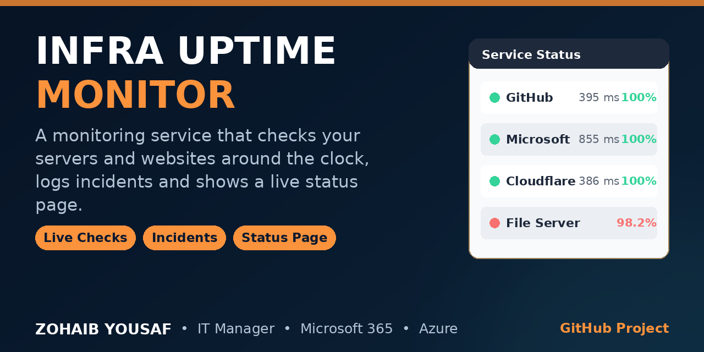

# Infra Uptime Monitor



A small infrastructure uptime monitoring service written in Python. It checks a list of HTTP targets on a schedule from a background thread, stores every check in a local SQLite database, opens an incident when a target fails repeatedly, and presents the results on a built-in status page and a JSON API. It is designed to be easy to run on a single server or workstation with no external services to install.

## Features

- Scheduled HTTP checks for any number of targets, each with its own interval
- Every check recorded in SQLite: timestamp, HTTP status code, response time in milliseconds, up/down result, and the error text when a check fails
- Automatic incident tracking: an incident opens after 3 consecutive failed checks and closes on the next successful check, with its duration recorded
- JSON API for target status, 24-hour uptime percentage, check history, incidents and an overall summary
- Server-rendered status page with live status indicators that refreshes itself every 30 seconds
- Zero infrastructure: one Python process, one SQLite file, no message queues, no external database

## Tech stack

- Python 3.12
- Flask 3 (web framework and status page)
- SQLite via the Python standard library (`sqlite3`)
- HTTP checks via the Python standard library (`urllib`), 5-second timeout
- Background checker thread via the Python standard library (`threading`)
- Tests with pytest

## Quick start

```bash
pip install -r requirements.txt
python app.py
```

Then open:

- Status page: http://127.0.0.1:5001/
- Summary API: http://127.0.0.1:5001/api/summary

The port can be changed with the `PORT` environment variable (default `5001`):

```bash
PORT=8080 python app.py
```

On first start the service creates `uptime.db` automatically, loads the targets from `config.json`, starts checking in the background, and serves the web interface.

## Configuration

Targets are defined in `config.json`. Each target has:

| Field | Required | Default | Meaning |
|---|---|---|---|
| `name` | yes | — | Display name of the target |
| `url` | yes | — | Full URL to request with an HTTP GET |
| `expected_status` | no | `200` | HTTP status code that counts as "up" |
| `interval_seconds` | no | `60` | Seconds between checks for this target |

The shipped `config.json` contains three sample targets (GitHub, Microsoft and Cloudflare). They are sample targets included so the service can be tried out immediately; replace them with your own servers and services, for example an internal web app, a client website, or a router's status page:

```json
{
  "targets": [
    {"name": "GitHub", "url": "https://github.com", "expected_status": 200, "interval_seconds": 60},
    {"name": "Company website", "url": "https://example.com", "expected_status": 200, "interval_seconds": 120},
    {"name": "Client portal", "url": "https://portal.example.org", "expected_status": 200, "interval_seconds": 300}
  ]
}
```

Restart the service after editing `config.json`; target settings are updated in the database while existing check and incident history is kept.

## API

All API responses are JSON.

| Method | Endpoint | Description |
|---|---|---|
| GET | `/api/targets` | All targets with current status (`up`, `down` or `unknown`), last check time, last response time in ms, and uptime percentage for the last 24 hours |
| GET | `/api/targets/<id>/history?limit=50` | Recent checks for one target, newest first (`limit` defaults to 50) |
| GET | `/api/incidents` | All incidents, open ones first, including start/end time and duration |
| GET | `/api/summary` | Totals: targets up/down/unknown, checks in the last 24 hours, overall uptime percentage, number of open incidents |

Uptime percentage is calculated as successful checks divided by total checks inside the window, rounded to 2 decimals. When a target has no checks in the window yet, its uptime is reported as 100.0 (nothing has been observed to fail).

The status page at `/` shows the same information as a table with a green, red or grey status dot per target, the 24-hour uptime, the last response time, the last check time, and a list of currently open incidents.

## How incidents work

- A check counts as failed when the request times out, the connection fails, or the returned HTTP status does not match the target's `expected_status`.
- After **3 consecutive failed checks**, an incident is opened for that target with the time of the third failure as its start.
- Further failures while the incident is open do not create additional incidents; a target has at most one open incident at a time.
- On the **next successful check**, the open incident is closed and its duration in seconds is stored.
- A later outage opens a new, separate incident, so the incident list becomes a history of outages per target.

## Running tests

```bash
python -m pytest -q
```

The test suite covers the uptime percentage calculation (including the empty-window case and checks outside the window), the incident rules (opens after 3 consecutive failures, no duplicates, closes on recovery with duration, a new outage opens a new incident), and the API endpoints using the Flask test client with a temporary database. The checker is driven by a stubbed check function in tests, so no real network access is needed.

## Project structure

```
infra-uptime-monitor/
├── app.py            Flask application: status page and JSON API routes
├── monitor.py        Checker thread, incident logic, SQLite storage and queries
├── config.json       Target definitions (sample targets included)
├── requirements.txt  Runtime dependency (Flask)
├── uptime.db         SQLite database, created automatically on first run
└── tests/
    ├── conftest.py   Test path setup
    └── test_monitor.py  Uptime, incident and API tests
```

## Author

Zohaib Yousaf — IT Manager & Web Developer
